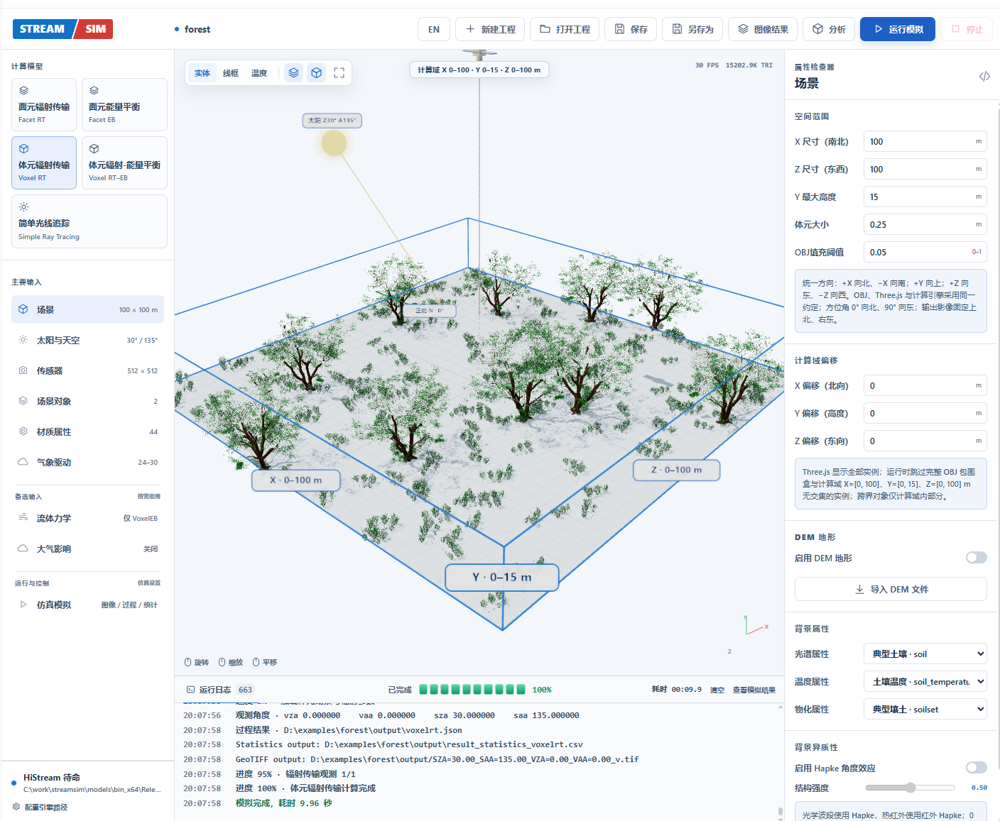
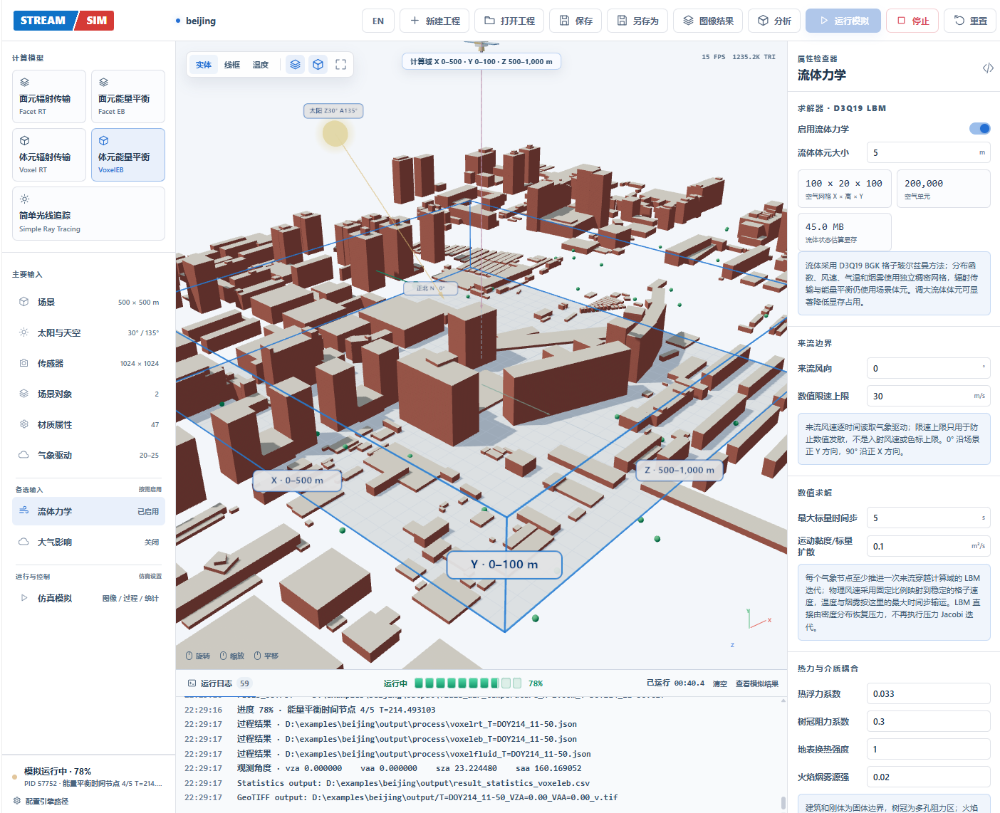
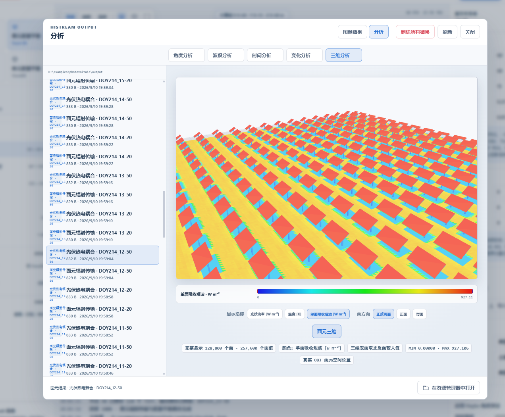
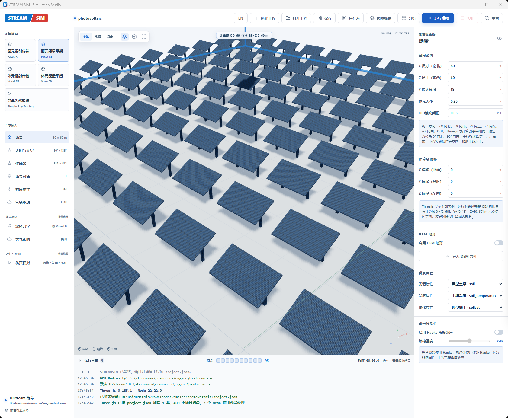
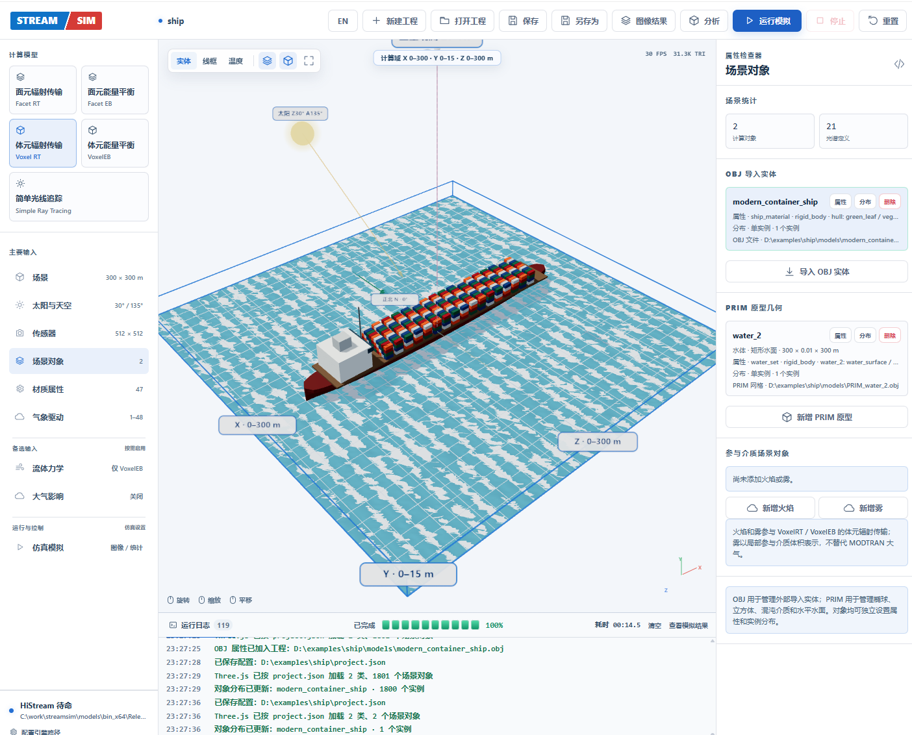
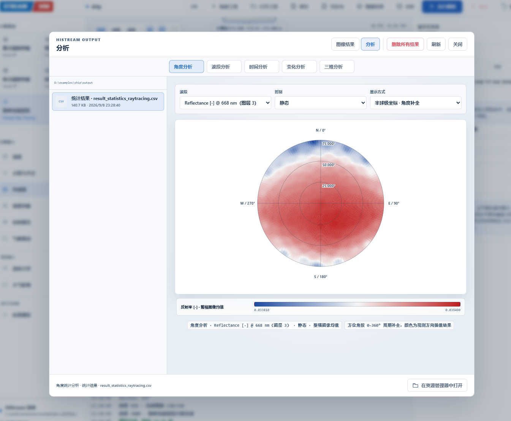

# Stream Studio

Stream Studio 是 STREAM 系列模型的统一桌面与 Web 平台，集成两个相互独立的引擎：STREAM 影像级引擎（`stream.exe`）和 STREAM 的高分辨率三维扩展 HiStream（`histream.exe`）。源码、编译结果和运行文件均集中在本项目目录。

当前版本 **2.0.0**：产品已从 HiStream Studio 更名为 Stream Studio，并集成 STREAM 影像级引擎。应用标识改为 `cn.stream.studio`，桌面程序为 `StreamStudio.exe`，安装包为 `Stream-Studio-Setup-<version>-x64-slim.exe`。由于应用标识改变，安装前请先卸载旧版；用户数据首次启动时从旧版目录迁移到 `%APPDATA%\Stream Studio`，桌面数据目录改为 `%LOCALAPPDATA%\StreamStudio`，默认输出与示例目录改为 `文档\Stream Studio`，环境变量前缀为 `STREAM_STUDIO_*`。2.0 的兼容边界见 [2.0 发布说明](docs/release-2.0.0.md)；1.1.4 的功能变更见 [1.1.4 发布说明](docs/release-1.1.4.md)，基础修复见 [1.1.3 修复说明](docs/release-1.1.3.md)。

## 命名约定

| 层级 | 名称 | 落点 |
| --- | --- | --- |
| 产品 | Stream Studio | `StreamStudio.exe`、`cn.stream.studio`、`STREAM_STUDIO_*` 环境变量、三维工程 `stream-studio-project` |
| 模型族 | STREAM | 论文、理论手册 |
| 影像级引擎 | STREAM | `stream.exe`、`models/stream/`、`/api/stream/*`、`stream-*` 格式标识 |
| 高分辨率三维扩展 | HiStream | `histream.exe`、`histream-usd.exe`、`models/histream/`、`HISTREAM_*` 引擎变量、`histream-*` 格式标识 |

旧产品名 StreamSim、HiStream Studio 只用于读取旧数据：`streamsim-project` 工程、USD 中的 `streamsim:*` 属性与 `customLayerData.streamsim`、`%APPDATA%\StreamSim` 与 `%APPDATA%\HiStream Studio` 用户数据，以及 `HISTREAM_STUDIO_*` 应用环境变量别名。新写出的文件一律使用上表中的名称。

## 结果展示

<table>
  <tr>
    <td width="50%" align="center">
      <br>
      <strong>森林场景构建与三维预览</strong>
    </td>
    <td width="50%" align="center">
      <br>
      <strong>城市建筑三维场景</strong>
    </td>
  </tr>
  <tr>
    <td width="50%" align="center">
      <br>
      <strong>作物场景表面温度分布</strong>
    </td>
    <td width="50%" align="center">
      <br>
      <strong>光伏阵列三维场景</strong>
    </td>
  </tr>
  <tr>
    <td width="50%" align="center">
      <br>
      <strong>船舶与海面场景</strong>
    </td>
    <td width="50%" align="center">
      <br>
      <strong>热红外角度效应</strong>
    </td>
  </tr>
</table>

## 1.1 重点：异质性体元

Stream Studio 1.1 着重完善了异质性体元工作。传统均质体元只给每个体元一种平均介质属性，网格变粗后容易丢失树叶聚集、枝叶空隙、建筑—植被交错和不同地物重叠形成的方向遮挡。异质性体元在体元化阶段回到原始 OBJ 三角面，对每个有效体元一次性提取真实结构统计量：

- 叶面积/结构体密度 `rho`，描述体元中“有多少结构”；
- X、Y、Z 三个方向的聚集指数 `CIx/CIy/CIz`，描述结构“如何排列和遮挡”；
- 最重要的两个地物类别及其遮挡贡献权重，用于综合光谱、温度与物化属性。

正式 VoxelRT/VoxelEB 求解时不再逐面追踪体元内部几何，而是根据射线方向组合三轴聚集指数，并以 `rho × G × CI(direction)` 进入消光、直射、天空漫射、多次散射和热辐射计算。这样既保留粗体元内部的方向异质性，又维持体元方法适合森林、作物和城市大场景的计算规模。该功能可在“仿真控制 → 异质性体元”中启用；均匀或低细节场景可关闭以减少预处理时间。

详细算法、适用边界和验证方法见[模型理论手册：异质性体元](docs/theory-manual.md#6-异质性体元11-重点)。

## 遥感影像模拟（STREAM）

Stream Studio 内置两个互相独立的引擎：HiStream（`histream.exe`）负责高分辨率三维场景，STREAM（`stream.exe`，源码在 `models/stream/`）负责遥感影像。两者的代码、服务端接口、任务队列、工程与输出各自独立，只共用桌面外壳和菜单栏。

菜单栏“遥感影像模拟”打开 STREAM 工作台。一次模拟对应一个 UTC 过境时刻，输入地表类型 IGBP、LAI、土壤水分、DEM、经纬度（可由 GeoTIFF 地理参考换算）和观测天顶/方位角，得到整景光学反射率（PROSPECT + BSM + STREAM 方向闭合）和热红外亮温。组分温度有两种来源：

- **RT**：已知组分温度，给出 Tss/Tsh/Tcs/Tch（常数、栅格或 4 波段组分温度文件）；
- **EB**：未知温度，用登记好的 ERA5 / ERA5-Land 数据包（一天到一年均可）驱动，从过境当天 00 UTC 逐时次求解四组分能量平衡（tirt 解析长波、Farquhar 气孔、强迫–恢复土壤热）到过境时刻；土壤水分取 ERA5 或用户输入，城市按四组分简化。内置示例“北京市 Landsat 影像-ERA5 单日驱动”附带 2019-08-15 单日 ERA5 数据。

结果为保留原网格和坐标系的 GeoTIFF。使用方法见[模型使用手册 5.2 节](docs/user-manual.md#52-遥感影像模拟stream)，引擎与物理模块说明见 [models/stream/README.md](models/stream/README.md) 和 [models/stream/PORTING.md](models/stream/PORTING.md)。

```text
streamstudio/
├─ src/renderer/                GUI 源码（src/renderer/src/stream/ 为 STREAM 工作台）
├─ gui/                         GUI 编译结果
├─ server.mjs                   Node 后端（HiStream 部分与桌面外壳）
├─ server/stream/               STREAM 服务端模块（/api/stream/*、任务队列、事件）
├─ assets/                      内置 OBJ、DEM、光谱和大气数据
├─ build/histream/              HiStream CMake 中间文件
├─ build/stream/                STREAM CMake 中间文件
├─ models/
│  ├─ histream/                 HiStream 源码、shader 和属性库
│  ├─ stream/                   STREAM 遥感影像引擎源码、地类参数与系数（stream.exe）
│  ├─ bin_x64/Release/          histream.exe 与 stream.exe Release 编译结果（STREAM 数据在 stream-defined/）
│  └─ nvpro_core/               HiStream 公共 C++ 依赖源码
├─ desktop/                     Electron 桌面端入口
├─ statistic/                   结果统计脚本
└─ tools/                       构建、打包和数据生成脚本
```

启动：

```powershell
cd C:\work\streamstudio
npm install
npm run build:gui
npm start
```

浏览器打开 `http://127.0.0.1:4173`。本地 API 只接受来自本机地址、`Content-Type: application/json` 的请求，以防其他网页跨站调用。

文档：

- [模型使用手册](docs/user-manual.md)
- [模型理论手册](docs/theory-manual.md)
- [地表温度与组分温度反演：方法与接口](docs/lst-lsct-inversion.md)

统一构建：

```powershell
npm run build:all
```

`build:all` 先编译 GUI，再编译 Release 引擎。CMake 优先使用环境变量 `VCPKG_ROOT`，未设置时会查找项目同级的 `vcpkg` 目录。

模型重新编译入口：

- `models/histream/CMakeLists.txt`
- `models/histream/src/main.cpp`
- `models/histream/src/base/engine.cpp`
- `models/histream/src/facetrt/`（Facetrt、FacetrtIO、Vulkan 核心）
- `models/histream/src/faceteb/`（Faceteb、FacetebIO）
- `models/histream/shader/facetrt/`
- `models/histream/shader/faceteb/`

CMake 编译仍需要本机 Vulkan SDK、Visual Studio 和 vcpkg 依赖。`eFacetRT` 和 `eFacetEB` 现在统一由 `histream.exe` 调用，分别加载 `shader/facetrt` 和 `shader/faceteb`；运行时不再调用独立 `radiosity_web_runner.exe`。

## SCOPE 对比资料

唯一保留的一组对比资料位于本机外部目录 `D:\cases\StreamStudio\模型对比\SCOPE`，不随项目源码或安装包分发。只有用户明确要求与 SCOPE 对比时才执行；日常开发、修复、构建、打包和发布不运行任何测试或对比。历史对比说明与结果保存在该目录。

## 主要参考文献

1. Bian, Z., et al. (2017). Modeling the Temporal Variability of Thermal Emissions From Row-Planted Scenes Using a Radiosity and Energy Budget Method. *IEEE Transactions on Geoscience and Remote Sensing*. [DOI: 10.1109/TGRS.2017.2719098](https://doi.org/10.1109/TGRS.2017.2719098)
2. Bian, Z., et al. (2018). Modeling the Distributions of Brightness Temperatures of a Cropland Scene Using the Radiosity and Energy Budget Methods. *Remote Sensing*, 10(5), 736. [DOI: 10.3390/rs10050736](https://doi.org/10.3390/rs10050736)
3. Bian, Z., et al. (2020). Modeling the Directional Anisotropy of Fine-Scale TIR Emissions Over Tree and Crop Canopies Based on UAV Measurements. *Remote Sensing of Environment*, 252, 112150. [DOI: 10.1016/j.rse.2020.112150](https://doi.org/10.1016/j.rse.2020.112150)
4. 卞尊健等（2021）. 光学遥感三维计算机模拟模型的研究进展与应用. *遥感学报*. [DOI: 10.11834/jrs.20219274](https://doi.org/10.11834/jrs.20219274)
5. Bian, Z., et al. (2022). A GPU-Based Solution for Ray Tracing 3-D Radiative Transfer Model of Complex Land Surface Scenes. *IEEE Geoscience and Remote Sensing Letters*. [DOI: 10.1109/LGRS.2022.3206312](https://doi.org/10.1109/LGRS.2022.3206312)
6. Fan, M., et al. (2024). Modeling the Topographic Effect on Directional Anisotropies of Land Surface Temperature. *Journal of Remote Sensing*. [DOI: 10.34133/remotesensing.0226](https://doi.org/10.34133/remotesensing.0226)
7. Fan, M., et al. (2025). STREAM: A System for Tracing Radiative Transfer and Energy Balance in Three-Dimensional Land Surface Scenes. *International Journal of Applied Earth Observation and Geoinformation*, 104763. [DOI: 10.1016/j.jag.2025.104763](https://doi.org/10.1016/j.jag.2025.104763)
8. Bian, Z., et al. (2025). Evaluation of Three Modeling Frameworks of Thermal Infrared Radiative Transfer for Directional Anisotropies of Temperatures. *IEEE Transactions on Geoscience and Remote Sensing*, 63, 5001315. [DOI: 10.1109/TGRS.2025.3530503](https://doi.org/10.1109/TGRS.2025.3530503)

完整理论说明和分章节参考文献见[模型理论手册](docs/theory-manual.md)。

## 许可证 / License

本项目采用 [PolyForm Noncommercial License 1.0.0](LICENSE)。允许依照许可证进行非商业使用、修改和分发；任何商业使用均须事先取得许可方的单独书面授权。

This project is licensed under the [PolyForm Noncommercial License 1.0.0](LICENSE). Noncommercial use, modification, and distribution are permitted under its terms. Commercial use requires a separate prior written license from the licensor.
