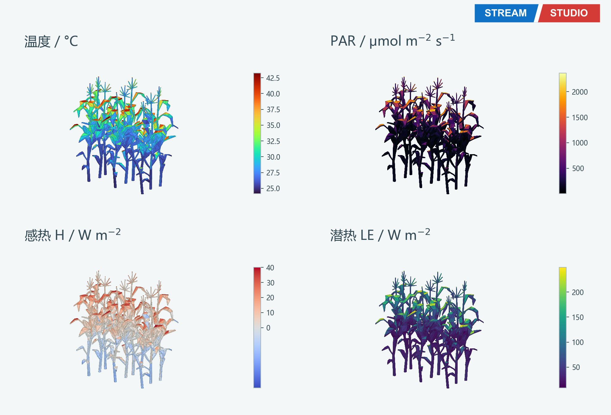
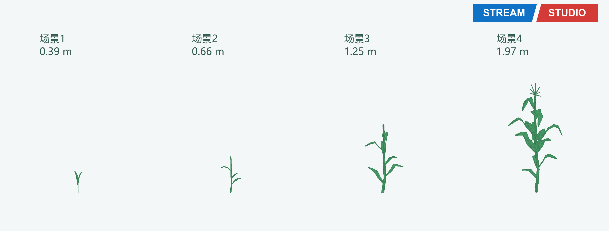
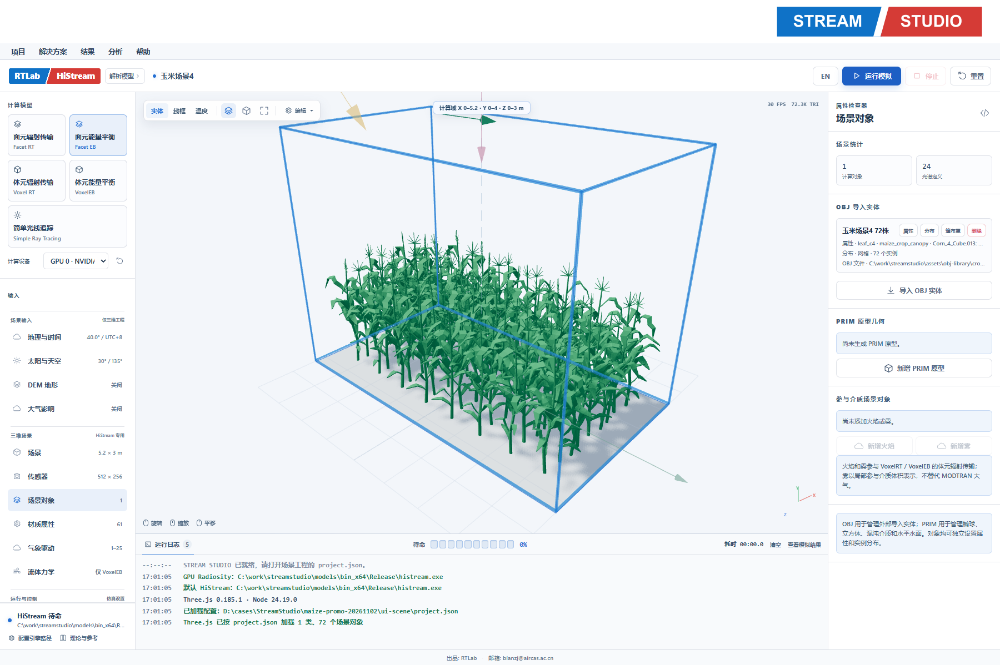
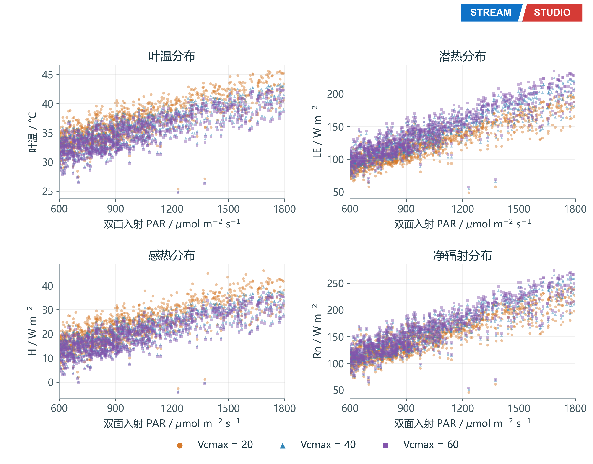
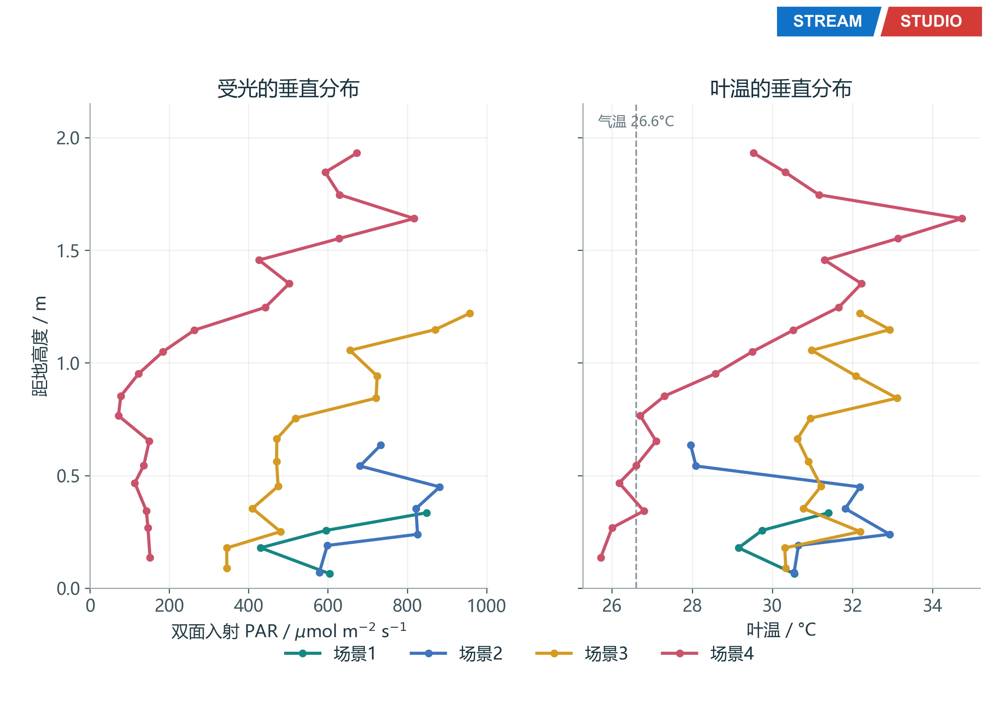

# 案例001 玉米光热转换

理想化玉米场景，包含四个生长阶段和Vcmax 20/40/60对照；尚非连续全季模拟，未完成独立观测验证。

[Word图文报告](report.docx)

## 打开工程

下载整个仓库后，复制 `examples/research-cases` 到全英文可写目录，保持 `inputs` 与各案例文件夹的相对关系，再在StreamStudio打开以下工程。输出写入工程目录下的 `output`。

- [project-stage-01.json](../../../examples/research-cases/001-maize/project-stage-01.json)
- [project-stage-02.json](../../../examples/research-cases/001-maize/project-stage-02.json)
- [project-stage-03.json](../../../examples/research-cases/001-maize/project-stage-03.json)
- [project-stage-04.json](../../../examples/research-cases/001-maize/project-stage-04.json)
- [project-vcmax-020.json](../../../examples/research-cases/001-maize/project-vcmax-020.json)
- [project-vcmax-040.json](../../../examples/research-cases/001-maize/project-vcmax-040.json)
- [project-vcmax-060.json](../../../examples/research-cases/001-maize/project-vcmax-060.json)
- [project.json](../../../examples/research-cases/001-maize/project.json)

本次上传仅核对输入文件与相对路径，未重新运行模型。完整历史原生结果和视频未纳入此仓库；图件为已归档结果，不能视为当前版本引擎的复算验收。

## 图件

