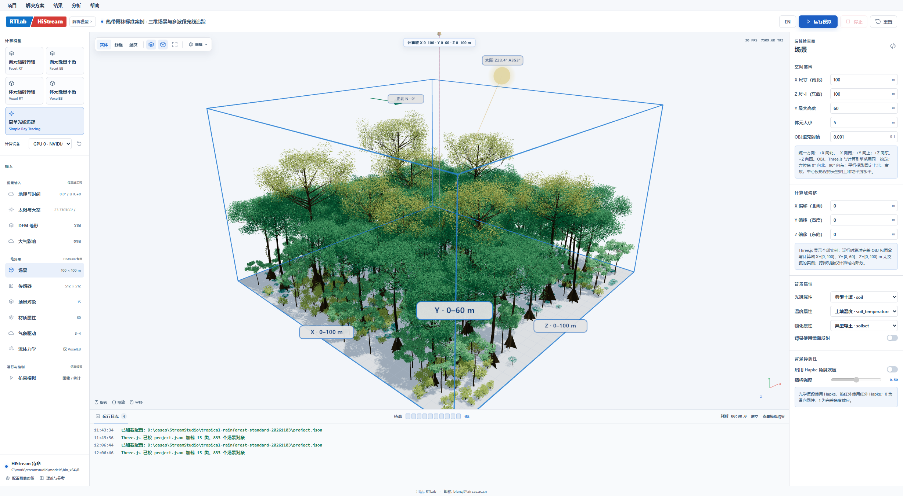
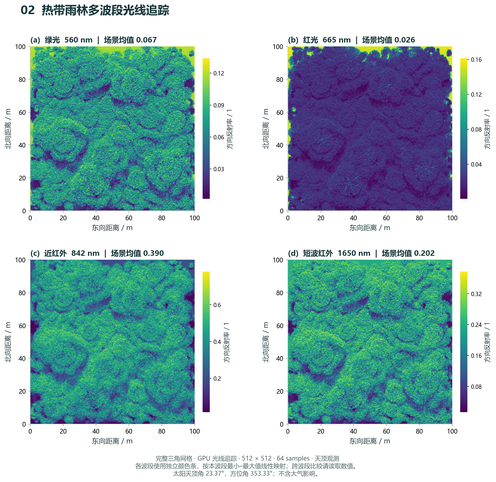
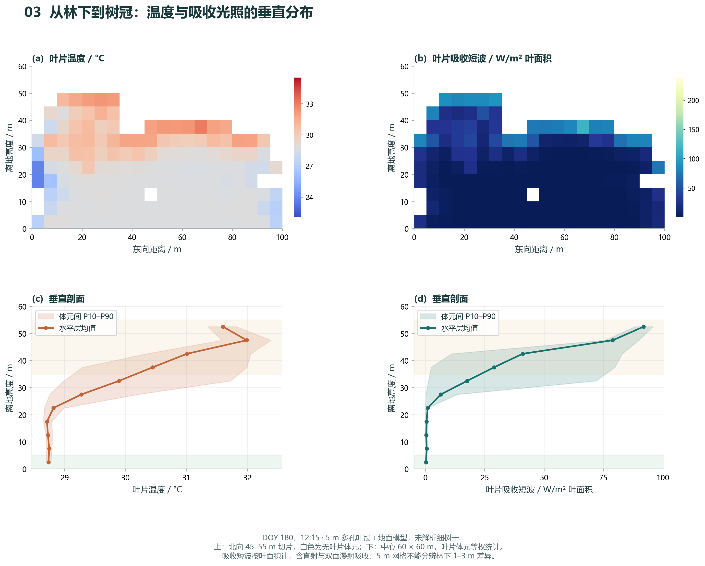
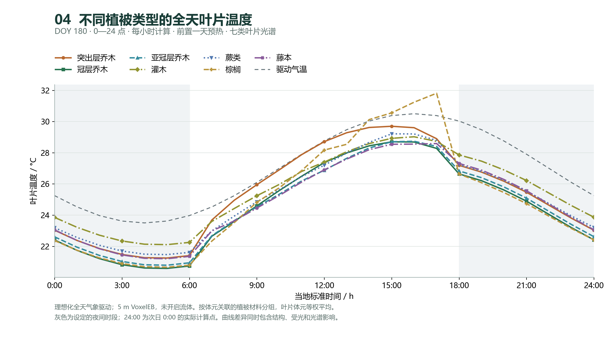

# 案例002 雨林分层光热

理想化森林与合成气象；5m混合体元按关联材料分组，棕榈样本仅9个体元；未完成独立观测验证。

[Word图文报告](report.docx)

## 打开工程

下载整个仓库后，复制 `examples/research-cases` 到全英文可写目录，保持 `inputs` 与各案例文件夹的相对关系，再在StreamStudio打开以下工程。输出写入工程目录下的 `output`。

- [project.json](../../../examples/research-cases/002-rainforest/project.json)
- [project-multiband.json](../../../examples/research-cases/002-rainforest/project-multiband.json)
- [project-canopy-baseline.json](../../../examples/research-cases/002-rainforest/project-canopy-baseline.json)
- [project-canopy-diurnal.json](../../../examples/research-cases/002-rainforest/project-canopy-diurnal.json)

本次上传仅核对输入文件与相对路径，未重新运行模型。完整历史原生结果和视频未纳入此仓库；图件为已归档结果，不能视为当前版本引擎的复算验收。

## 图件

