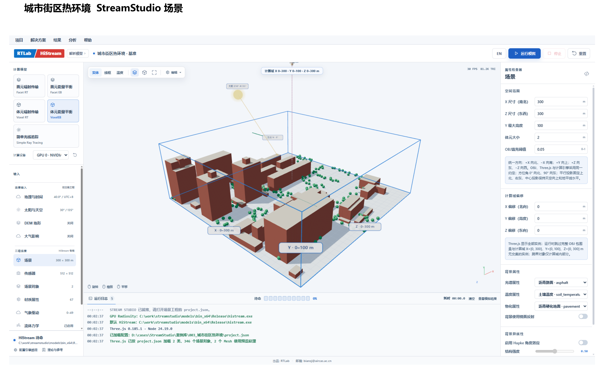
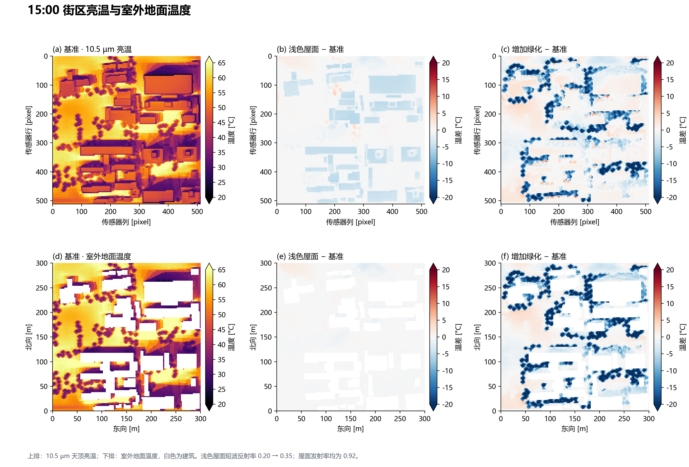
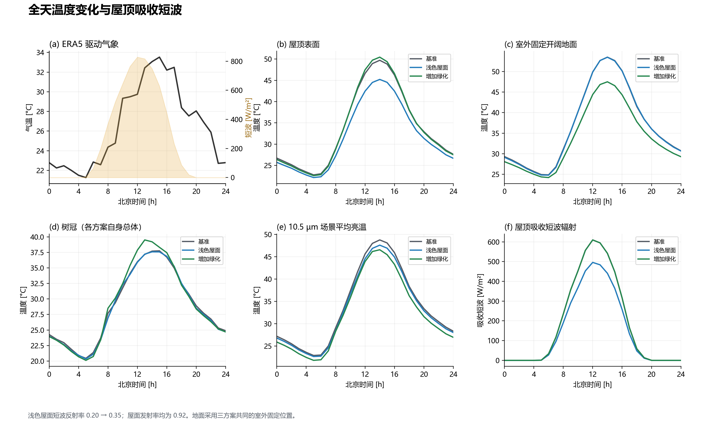
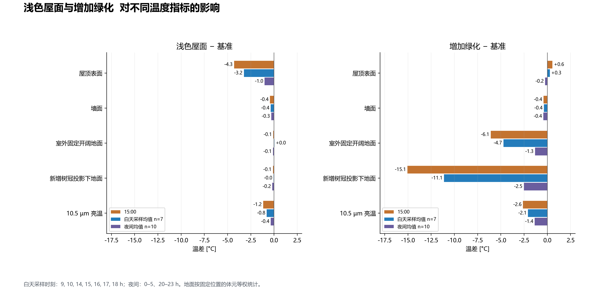
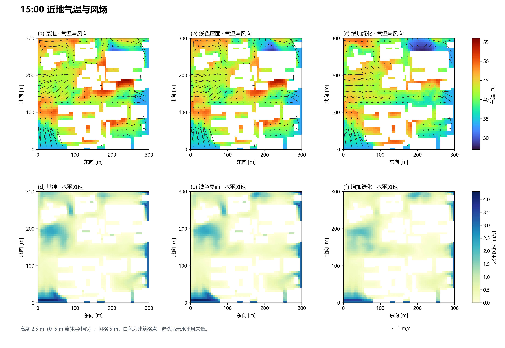

# 案例003 城市街区热环境

采用2026-11-05 v2修订：屋面反射率0.20→0.35，发射率0.92；共同通过时刻用于主要效果统计。绿化方案部分时刻残差未通过，空气温度绝对值偏高，未完成独立观测验证。

[Word图文报告](report.docx) · [当前修订版PDF](report-current.pdf)

Word保留归档版；本页图件、表格和PDF以v2修订为准。

## 打开工程

下载整个仓库后，复制 `examples/research-cases` 到全英文可写目录，保持 `inputs` 与各案例文件夹的相对关系，再在StreamStudio打开以下工程。输出写入工程目录下的 `output`。

- [baseline.json](../../../examples/research-cases/003-urban/baseline.json)
- [light-roof.json](../../../examples/research-cases/003-urban/light-roof.json)
- [greening.json](../../../examples/research-cases/003-urban/greening.json)

本次上传仅核对输入文件与相对路径，未重新运行模型。完整历史原生结果和视频未纳入此仓库；图件为已归档结果，不能视为当前版本引擎的复算验收。

## 图件

