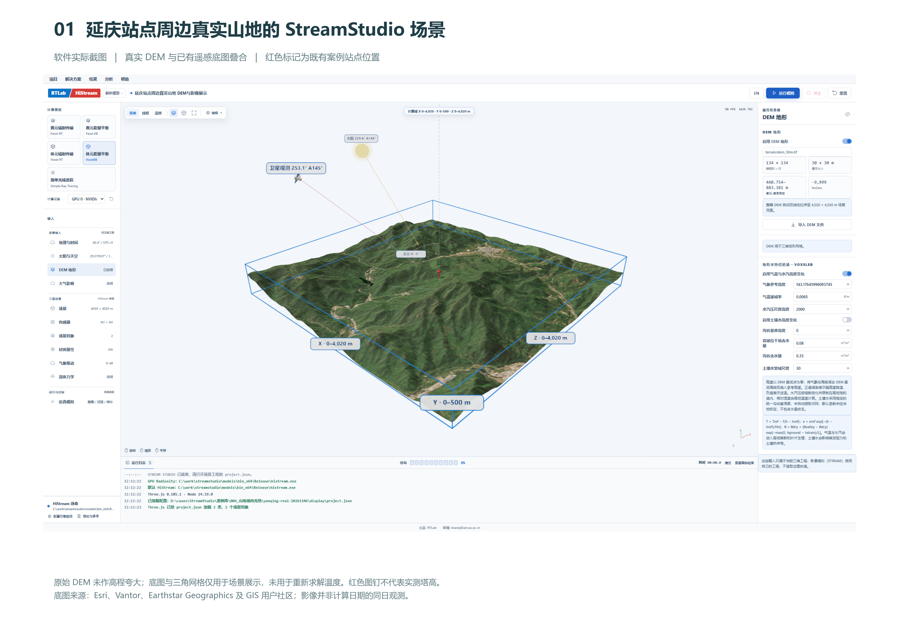
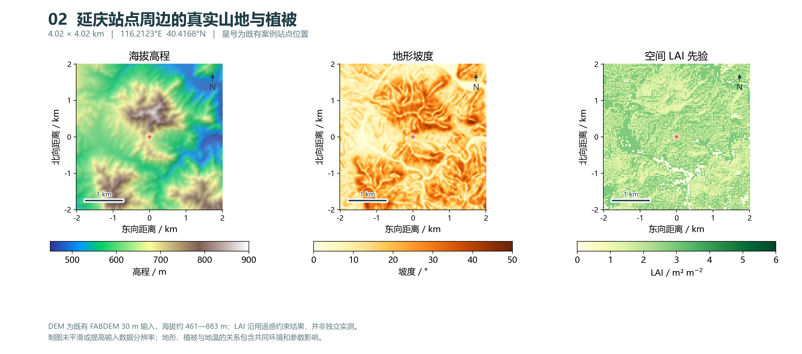
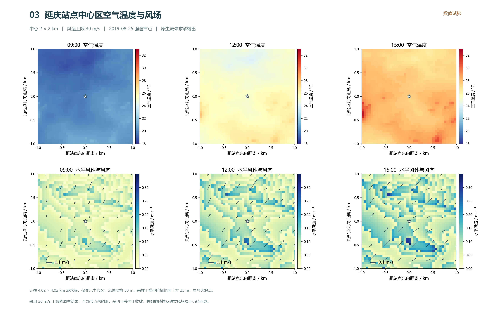
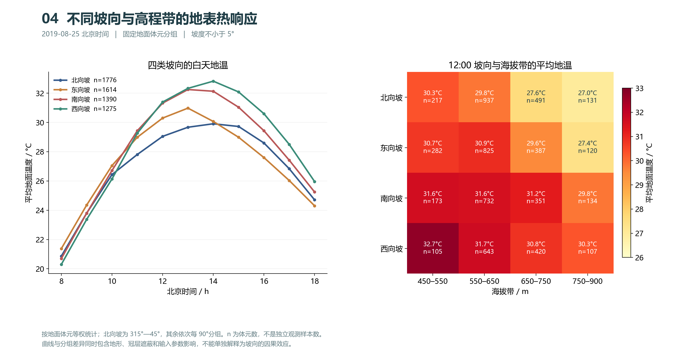
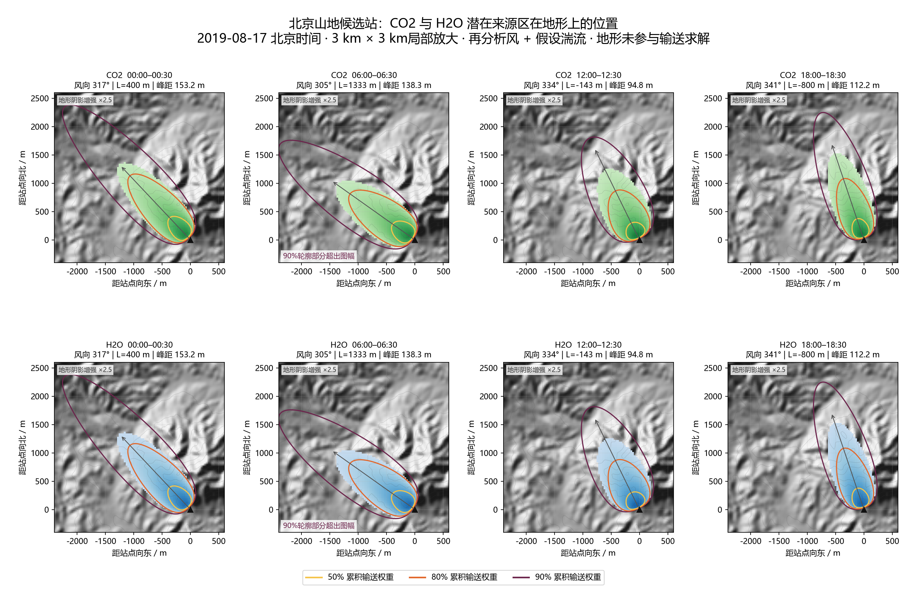

# 案例004 延庆山地光热与风场

真实地形演示。风速上限30m/s，图3仅显示中心2×2km、离阶梯地面25m的原生流体结果；裁切不代表收敛。图5为2019-08-17 FFP足迹情景，与其他图日期不同，未完成独立观测验证。

[Word图文报告](report.docx)

## 打开工程

下载整个仓库后，复制 `examples/research-cases` 到全英文可写目录，保持 `inputs` 与各案例文件夹的相对关系，再在StreamStudio打开以下工程。输出写入工程目录下的 `output`。

- [project.json](../../../examples/research-cases/004-yanqing/project.json)
- [fluid.json](../../../examples/research-cases/004-yanqing/fluid.json)
- [display.json](../../../examples/research-cases/004-yanqing/display.json)

本次上传仅核对输入文件与相对路径，未重新运行模型。完整历史原生结果和视频未纳入此仓库；图件为已归档结果，不能视为当前版本引擎的复算验收。display工程仅作三维场景展示。

## 图件

