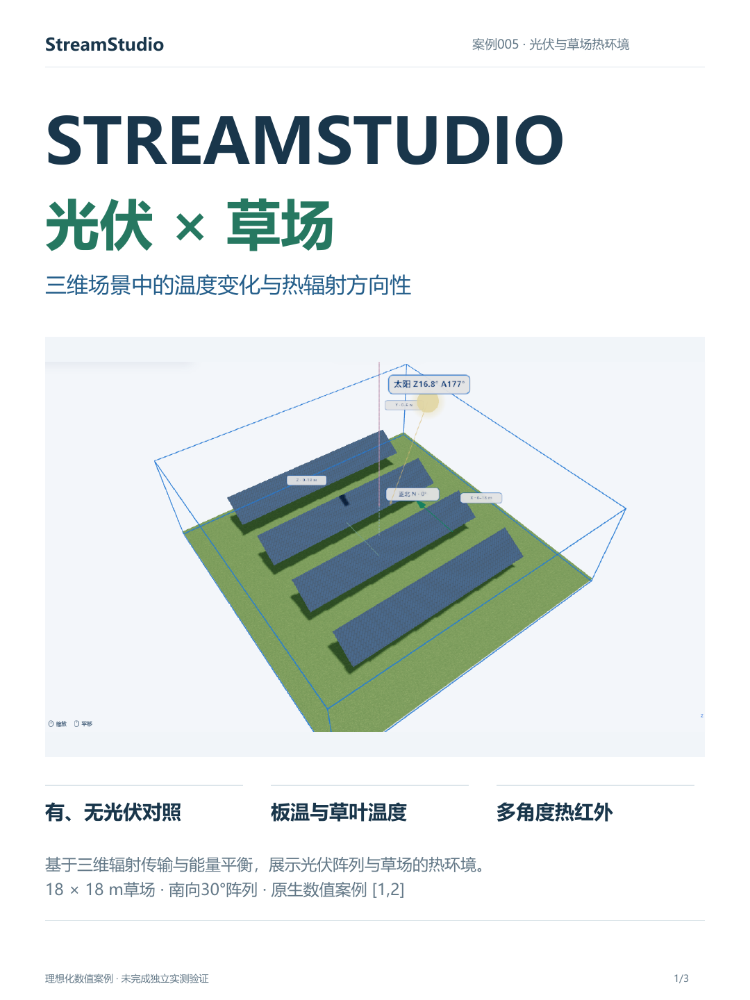
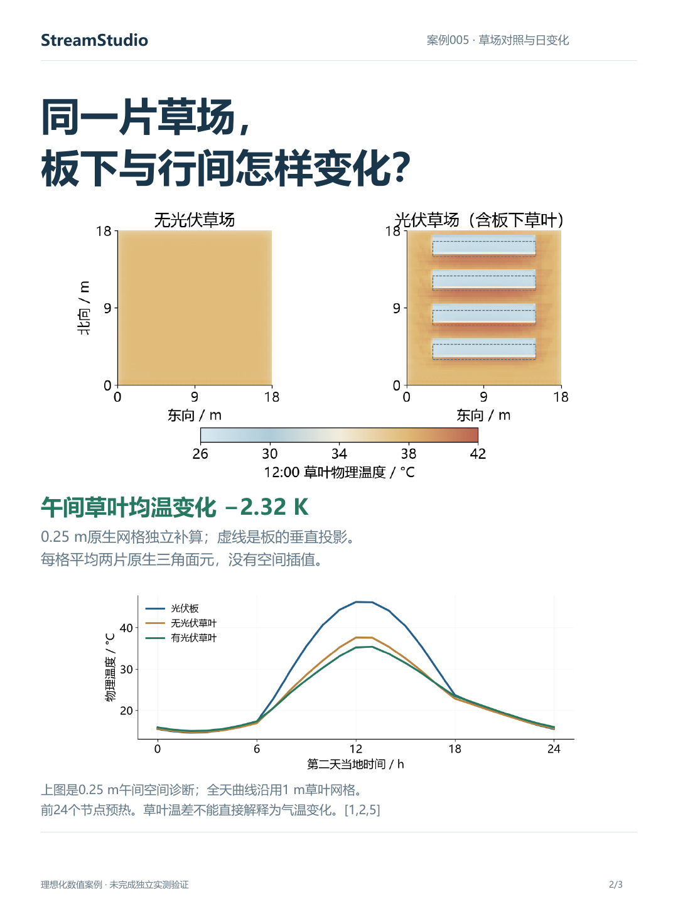
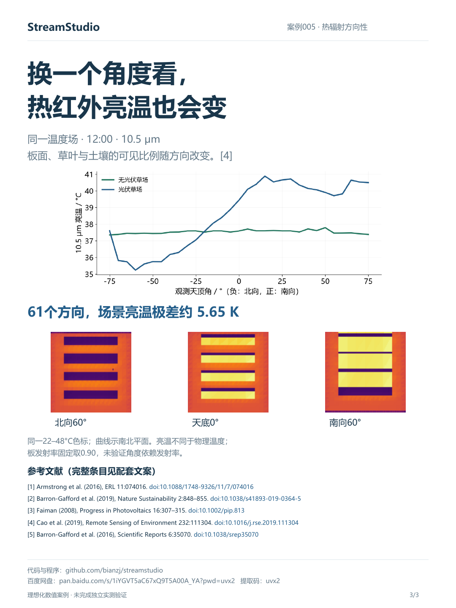

# 案例005：光伏草场热环境

用3张图介绍：StreamStudio光伏草场宣传封面、草场温度对照与热辐射方向性。

[3页PDF](report.pdf) · [小红书文案](小红书文案.md) · [知乎文章](知乎文章.md) · [参考文献](references-and-downloads.md)

基础温度与方向性采用1 m草叶网格；空间图独立补算0.25 m网格，二者分别标明。理想化数值教学案例，未完成独立实测验证；草叶温差不代表气温或区域热岛变化。

本次仅发布宣传材料，不包含工程输入与完整原生状态。
