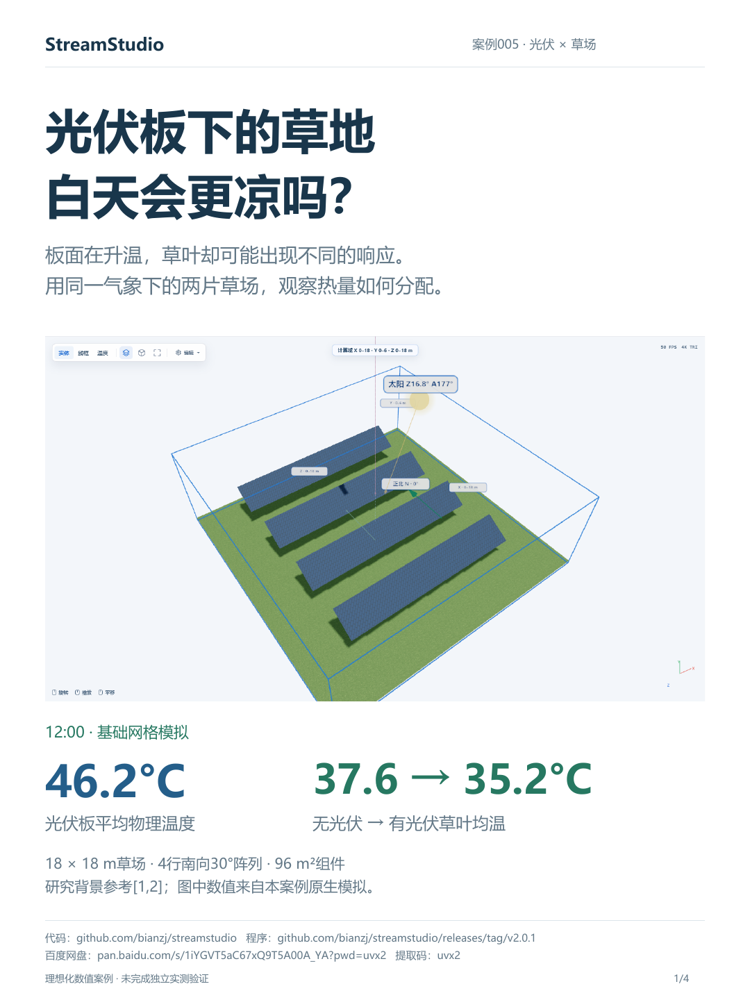
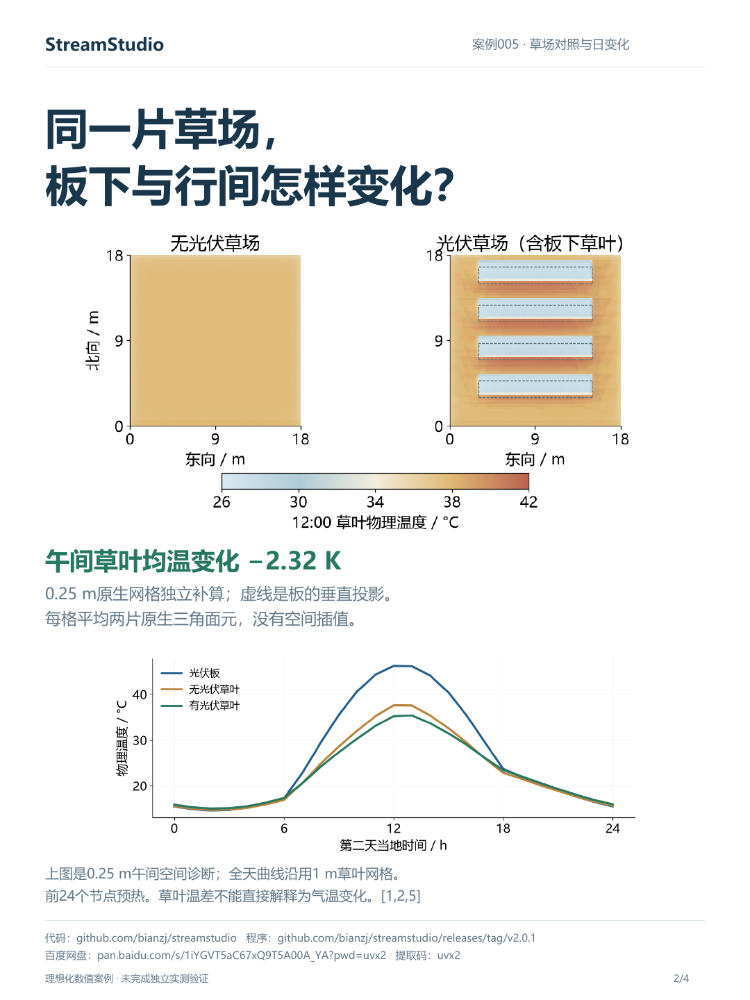
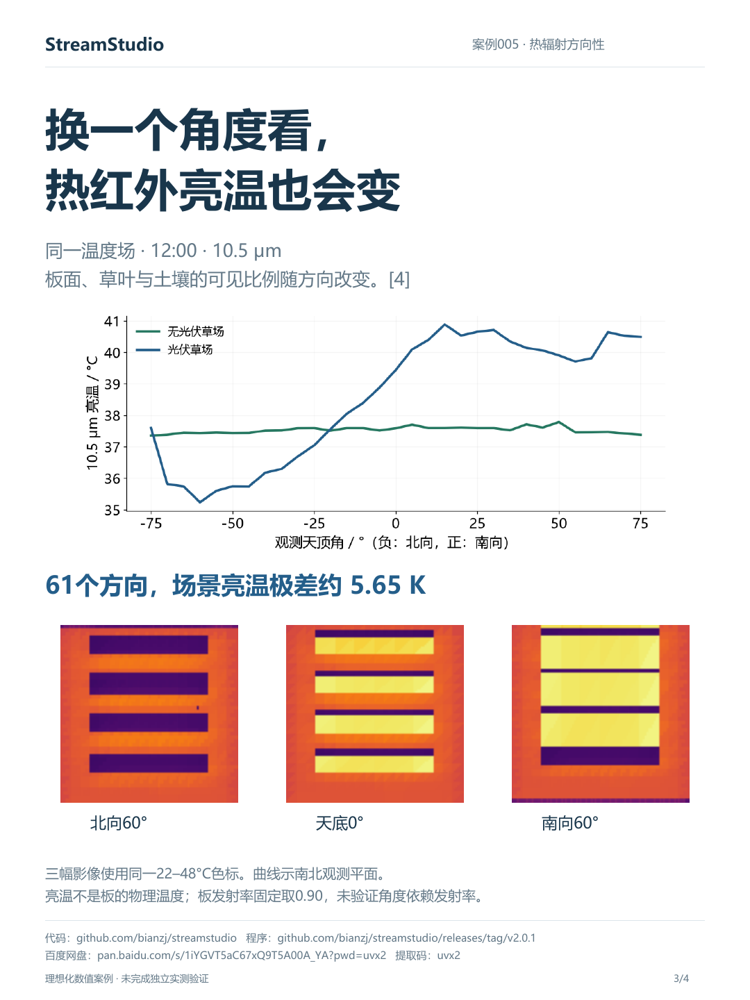
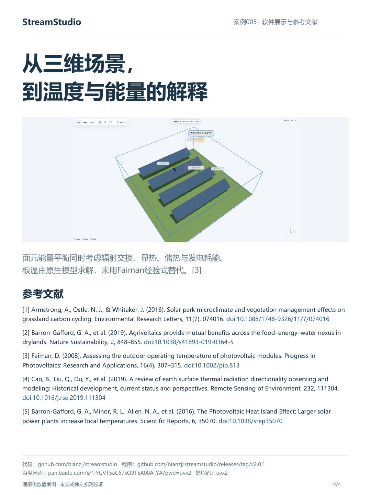

# 光伏板下的草地为何会变凉，热红外图像却仍然显热？

光伏板很热，并不意味着板下草叶以相同方式升温。草叶的物理温度、板的物理温度和传感器观测的热红外亮温，描述的是不同对象。

## 在同一气象下比较有、无光伏草场

本案例用StreamStudio建立18×18 m的草场，加入4行南向30°光伏阵列，总组件面积96 m²。两组使用相同的气象、土壤、草地与初始化。已有草地光伏场研究表明，板下、行间和对照区域的微气候响应会受到季节、地表和管理条件影响[1]；光伏与植被共存的收益也具有环境条件边界[2]。

基础网格的12时结果中，板平均物理温度约46.2°C；无光伏草叶均温约37.6°C，有光伏约35.2°C。草叶遮阴减少短波吸收，板面长波及天空遮挡也参与交换。白天的差异不能直接外推为全天或所有气候下的普遍规律。

空间图另外采用0.25 m草叶网格补算，午间全场草叶均温变化约−2.32 K。图中每格只平均两片原生三角面元，没有插值。全天曲线和下述方向性结果沿用1 m网格，避免将不同网格的数值混作同一组。

## 同一温度场，为什么从不同方向看到不同亮温？

从不同方向观察时，光伏板、草叶和土壤进入视场的比例不同，遮挡和反射天空长波也会改变观测。热辐射方向性综述对此给出了系统解释[4]。

本案例在09、12、15时各生成61个方向的热红外图像。12时，有光伏场景在所采方向的10.5 μm亮温极差约5.65 K。各图先平均有效像元辐亮度，再反演亮温；结果包含随视角变化的组分和投影边界，不能直接作为固定足迹的角度校正，也没有验证真实板面的角度依赖发射率。

## 软件中如何展示？

StreamStudio把光伏阵列、草地、太阳和观测方向放在同一场景中。面元能量平衡输出板温、草叶温度和能量通量，发电耗能参与板面能量分配。辐照、气温与风速对板温的影响可参考Faiman[3]；本案例并未以该经验式替代原生求解。

基础计算98节点及空间补算74节点全部通过引擎原生收敛判据。不过，收敛不等于独立科学验证。本案例是理想化教学对照，未模拟气温响应、草地生长或产草量。电站气温效应需要另行研究[5]，不能从草叶温差推出热岛增强或减弱。

## 参考文献

[1] Armstrong, A., Ostle, N. J., & Whitaker, J. (2016). Solar park microclimate and vegetation management effects on grassland carbon cycling. Environmental Research Letters, 11(7), 074016. https://doi.org/10.1088/1748-9326/11/7/074016

[2] Barron-Gafford, G. A., et al. (2019). Agrivoltaics provide mutual benefits across the food–energy–water nexus in drylands. Nature Sustainability, 2, 848–855. https://doi.org/10.1038/s41893-019-0364-5

[3] Faiman, D. (2008). Assessing the outdoor operating temperature of photovoltaic modules. Progress in Photovoltaics: Research and Applications, 16(4), 307–315. https://doi.org/10.1002/pip.813

[4] Cao, B., Liu, Q., Du, Y., et al. (2019). A review of earth surface thermal radiation directionality observing and modeling: Historical development, current status and perspectives. Remote Sensing of Environment, 232, 111304. https://doi.org/10.1016/j.rse.2019.111304

[5] Barron-Gafford, G. A., Minor, R. L., Allen, N. A., et al. (2016). The Photovoltaic Heat Island Effect: Larger solar power plants increase local temperatures. Scientific Reports, 6, 35070. https://doi.org/10.1038/srep35070

代码与软件资料：
- 源码：https://github.com/bianzj/streamstudio
- 程序：https://github.com/bianzj/streamstudio/releases/tag/v2.0.1
- 百度网盘：https://pan.baidu.com/s/1iYGVT5aC67xQ9T5A00A_YA?pwd=uvx2 ，提取码 uvx2。
