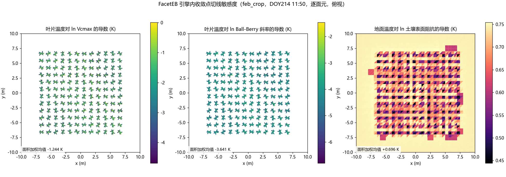

# HiStream 三维可微反演与神经代理（FacetEB 原型）

状态：研究原型（2026-11-27，第二轮）。Python 部分在 `tools/histream-ml/`（命令行，**未接入服务端和工作台**）；引擎新增**收敛点切线敏感度**（`control.facetSensitivity`）并做了两处修正。只在 `feb_crop`（20 m 玉米，FacetEB）上验证：两节点（DOY214 11:50、12:20）与 48 节点日循环。

## 1. 要解决什么、现在到哪一步

| 需求 | 做法 | 状态 |
|---|---|---|
| 三维场景参数反演需要梯度 | ① 代理自动微分；② **引擎内切线敏感度**（新）；③ 引擎差分作参考 | ①② 已实现并与 ③ 核对 |
| 结果必须以引擎为准 | 代理 MAP 后做引擎校正迭代；或**只用引擎**的 Gauss–Newton（雅可比取自 ②） | 两条路都已实现，统计 OSSE 验证 |
| 后验不确定度要可信 | Laplace 后验；代理误差按训练集交叉验证残差的协方差计入似然 | 覆盖率已检验（第 6.4 节） |
| 大规模扫描 / 先验 / 日循环 | MLP 集成代理，导出 ONNX | 两节点已验证；日循环见第 6.7 节 |
| 引擎内精确伴随（多参数、逐面元参数） | 设计见第 3 节 | **未实现** |

边界（不变）：精度口径是**类别/场景均值**——温度 0.1 K、辐射 0.25 W m⁻²，不是逐面元阈值。代理只用来加速和取梯度，**不替代已验证的求解器**；反演结果以引擎复核为准。HiStream 与 STREAM（二维，已有对偶数自动微分与 EB 隐式微分）的交互本轮不做。

## 2. 梯度从哪里来

| 层次 | 方法 | 成本（feb_crop，3 个参数） | 精度 | 状态 |
|---|---|---|---|---|
| G0 | 引擎外部中心差分（整次重跑） | 每参数 2 次运行 | 受求解器**停止误差**污染：± 两次运行在不同迭代步满足收敛判据而停止（实测 20 对 60 步），误差不抵消；小量导数会随步长不单调跳动（第 6.5 节） | 可用 |
| G1 | 代理自动微分 | 毫秒级 | 方向好（余弦 > 0.98），幅值在气孔参数上差 11–37% | 已实现 |
| **G2a** | **引擎内收敛点切线敏感度**（新） | 每参数每节点约 2.3 s（两侧各 24 次热启动迭代） | 两侧迭代数相同，停止误差一阶抵消；24/48/96 次结果相同；首节点与外部差分相差 0.1–4%（外部差分自身噪声更大的几项除外，见 6.3） | **已实现**（`facetrtcore.cpp`，4 个参数） |
| G2b | 收敛点隐式微分 / 离散伴随（引擎内） | 每个目标一次线性反解，与参数个数无关 | 精确（离散意义上） | 设计，未实现 |
| G3 | 几何 / 遮挡参数（LAI、叶倾角、植株位置） | — | 可见性分数分段常数，几何一变图就换 | 不做 |

### G2a：引擎内收敛点切线敏感度（已实现）

GPU 能量求解器已有的接口（`beginEnergyNode` / `evaluateEnergy` / `updateEnergyTemperature` / `readEnergyState`）允许用任意参数与初始温度重新开始一个节点，所以不改着色器：

1. 节点按原流程收敛并读出产品（主机状态不再改动）；
2. 对每个参数，把 GPU 参数槽乘以 (1 ± h)，从**收敛态温度热启动**，两侧各做同样 K 次耦合迭代（缺省 h = 0.05、K = 24）；
3. 按过程文件同一记录（潜热、显热、表面热通量、温度、净辐射、受光/阴影部分温度）取中心差分，得到**逐面侧** dY/d ln θ，写 `process/facetsens_T=<token>.bin`，类别均值另写进 `faceteb_run.json`。

要点：不能沿用原收敛判据——收敛态本来就满足它，扰动解会在第 0 步退出，导数为 0；固定且相同的迭代数让基态残余漂移在中心差分里抵消。可见性图、短波、天空、气象都不重算。

局限：**节点间热历史冻结**（上一节点的土壤/表面温度取未扰动值）；稳定度修正开启时 1/L 冻结；只支持 GPU 能量路径；目前 4 个参数：`leaf.vcmax`、`leaf.ballBerrySlope`、`ground.surfaceResistance`（GPU 参数槽），`ground.thermalConductivity`（按 λ(1 ± h) 在主机重算地面侧土壤柱响应，替换 GPU 输入槽的斜率与截距）。BSM 含水量要重算短波，还没接。用法与格式见 `docs/faceteb-gpu-energy.md` 的 2026-11-27 一节。

## 3. 未做：伴随（G2b）设计与前提核对

收敛点处面元能量残差 R(T, x) = 0，所以 dT/dx = −(∂R/∂T)⁻¹ ∂R/∂x；对目标 L，dL/dx = −λᵀ ∂R/∂x，(∂R/∂T)ᵀ λ = ∂L/∂T。代价与参数个数无关，适合**逐材料 / 逐面元参数**（例如逐株 Vcmax）。本轮读代码核对的前提：

- 耦合迭代就是对 R 的阻尼牛顿（`facetrtcore.cpp` 的 CPU 路径与 `energy.comp` phase 1），∂R/∂T 的对角部分（辐射、显热、潜热、储热斜率）已在通量槽里，**可直接用**；
- 非对角部分是面元间长波交换：GPU 上按**接收侧** CSR 收集（`faceteb/radiosity.comp:117`，每侧一行，逐边读邻面辐射度，另有 `ground_mean.comp` 的等效地面均值作全局耦合）。转置作用需要按发射侧的 CSR（主机重排一次）或原子散射，**要新写着色器**；
- 叶片温度与气孔阻抗联立求解，气孔二分在 ln r_s 差 ≤ 0.01 时退出（`faceteb-gpu-energy.md`）。这一退出带宽会让 ∂R/∂T 在叶片上不光滑；G2a 用 5% 的有限步长绕过了它，G2b 需要把气孔根当成收敛点上的隐函数解析求导，**需要改 `energy.comp` 的叶片分支**；
- 跨节点：土壤热历史（`soilResponses`/`soilHistory`）和上一节点温度是状态，伴随要逆时间传递，工作量与正向的状态管理同量级。

结论：G2b 可行，但需要新的转置辐射着色器、叶片根的解析导数和逆时间状态传递，工作量远大于 G2a。在参数少（≤ 10 个全局参数）的情况下 G2a 已够用；参数多（逐面元）或需要跨节点精确梯度时再做。

## 4. 引擎修正（2026-11-27）

| 修正 | 内容 | 对数值的影响 |
|---|---|---|
| 未收敛面元计数自检 | 主机重数与 GPU 归约的计数差 ≤ 面元总数 1% 只警告；节点用满迭代预算时不终止（运行优先）；提前收敛且差 > 1% 仍报错。每节点记录 `energyFailingFacetsHostRecount` / `energyFailingFacetCountDifference` | 无（只改是否终止）。原先在 Vcmax≈87.4、rss≈3430、λ≈1.63 的组合上可复现的终止现在正常完成（节点 24 计数 20 对 19） |
| BSM 含水量 ≤ 5% 取干土光谱 | `compo.cpp`，与 SCOPE BSM、STREAM（`optics.cpp:194`）一致 | 只影响 SMC < 5% 的工程：此前反射率被外推得比干土更亮（地面 Rn 在 SMC 2/3/4/5% 为 471.5/473.9/476.3/478.5 W m⁻²，现在都是 478.5，连续、单调）。缺省点（SMC 25）全部产品逐位不变 |
| 切线敏感度 | 见第 2 节 | 关闭时与此前逐位相同；**开启时原有产品也逐位相同**（含影像，10 个文件核对） |

SMC 以 1 为界的百分数/小数约定（`SMC ≤ 1` 按小数）按决定**未改**：SMC=1 仍表示饱和。

## 5. 原型的结构

```
参数 θ ──引擎 histream.exe eFacetEB──> 类别均值观测向量 y ──┐
  │        └─ control.facetSensitivity ─> 引擎雅可比 J_e（G2a）│
  └── Sobol 采样 ──训练──> MLP 集成代理 y_s(θ) ─自动微分─> J_s │
                                                              ▼
 观测 y_obs ─ MAP（白化残差 + 先验，盒约束）─> θ̂, Laplace 后验
   路线 A：代理 MAP（代理误差协方差）→ 引擎校正迭代（代理雅可比 + 引擎残差）
   路线 B：只用引擎的 Levenberg–Marquardt（J_e，不支持的列用引擎差分）
```

- **参数空间**（`hsml/params.py`，归一化到 [0,1]）：v1 = Vcmax（25–120）、Ball-Berry 斜率 m（2–9）、土壤导热率 λ（0.4–2.5 W m⁻¹ K⁻¹）、土壤表面阻抗 rss（500–6000 s m⁻¹，对数）+ 强迫扰动（气温偏移 ±4 K、风速倍率 0.5–2、短波倍率 0.6–1.05）；v2 = v1 + BSM 光谱含水量（5–40%，写 `spectra[soil].params.SMC`）。数据与模型记录所用空间，读取时自动切换。
- **观测向量**：每节点叶片类（面积加权，几何法向侧）T、Tsun、Tsh、LE、H、Rn、G，地面类 T、LE、H、Rn、G。两节点 24 维，日循环 576 维。
- **代理**：y = A·u + MLP(u)，3 层 96 宽 SiLU，5 成员；权重衰减 1e-4（训练集交叉验证选出）。
- **代理误差（新口径）**：训练集 5 折交叉验证（每折 5 成员）的样本外残差，取二阶矩 E[r rᵀ]（含输出间相关），相关矩阵向单位阵收缩（样本少于维数时必需，第 6.7 节），在似然里与观测噪声相加后白化。此前用测试集 RMSE（对角）：测试集同时被用来检验，有泄漏，而且忽略相关。集成成员离散度**不能**当代理误差：测试集 RMSE 约为离散度的 2–2.5 倍。
- **引擎校正**：在信赖域（u ± r）内解校正后的 MAP，见第 6.7 节。

## 6. 验证结果（feb_crop，RTX PRO 6000）

### 6.1 代理精度（两节点，64 个独立测试点）

| 训练点数 | 温度 RMSE 中位 / 最大（K） | 通量 RMSE 中位 / 最大（W m⁻²） |
|---|---|---|
| 127 | 0.120 / 0.152 | 1.30 / 2.36 |
| 254 | 0.072 / 0.083 | 0.77 / 1.62 |
| **509** | **0.056 / 0.062** | **0.62 / 1.20** |

温度全部达标；通量中位约为目标 2.5 倍，学习曲线仍在下降。交叉验证 RMSE 约为测试集 RMSE 的 1.28 倍（中位，范围 1.10–1.58；每折少 20% 训练数据），所以按它算的代理误差偏保守。

### 6.2 代理梯度 vs 引擎外部差分（3 个测试点）

方向余弦 0.983–1.000；幅值：强迫与土壤参数 0.4–14%，Vcmax 与气孔斜率 11–37%。代理梯度只适合找下降方向。

### 6.3 引擎内切线敏感度（G2a）的验证

**首节点**（两种方法初值相同）：引擎内 d/d ln θ 与外部重跑差分（h = 5%）：

| 参数 | 叶片温度 | 叶片潜热 | 地面温度 | 地面储热 |
|---|---|---|---|---|
| Vcmax | −1.2441 / −1.2411 K | +18.96 / +18.98 | −0.0142 / −0.0143 K | −0.464 / −0.467 |
| 土壤阻抗 | +0.0631 / +0.0623 K | +0.413 / +0.398 | +0.6963 / +0.6962 K | +22.75 / +22.74 |
| Ball-Berry 斜率 | −3.641 / −3.720 K | +54.0 / +53.3 | −0.0585 / −0.0751 K | −1.91 / −2.45 |

斜率的地面项差 22–28%，用不同步长/迭代数核对后确定**是外部差分不准**：引擎内结果随迭代数收敛（24/48/96 次：−0.0585/−0.0585/−0.0585），随步长平滑变化（h = 5/10/20%：−0.0585/−0.0599/−0.0660）；外部差分随步长不单调（−0.0751/−0.0686/−0.0738），因为 ± 两次运行分别在第 20 和第 60 步停止。斜率的响应很非线性：h = 20% 时叶温导数比 h = 5% 大约 20%。

**土壤导热率**（后加，第 2 节）：首节点地面量与外部差分相差 < 0.6%（地面温度 −3.751 对 −3.737 K，地面储热 +73.55 对 +73.97 W m⁻²）；叶片量外部差分随步长跳动（叶温 −0.276/−0.361，h = 5/10%），引擎内值 −0.336 落在中间，同样是外部差分的停止误差。

**第二节点**（热历史冻结的影响）：叶片类导数与外部差分仍在 2% 内（Vcmax 对叶温 −1.488 对 −1.483）；地面类与土壤参数偏差明显，例如 Vcmax 对地面储热 −0.56 对 −0.31，土壤阻抗对地面温度 0.94（冻结）对 1.15（完整）、对地面储热 30.7 对 26.5；土壤导热率较小（地面温度 −4.06 对 −4.22，约 4%）。所以**地面量与土壤参数跨节点的导数要用完整历史**（外部差分或代理），日循环里尤其如此。

**成本**：3 个参数每节点约 7 s（GPU 与其他任务共享时测得），外部差分整次重跑 2 节点 × 3 参数共 36 s。**逐面元导数场**是外部类别均值差分给不出的空间信息（图 1）：植株外缘叶片对 Vcmax 更敏感；冠层下的地面对土壤阻抗的敏感度（0.45–0.6 K）比裸地（约 0.75 K）低。



### 6.4 统计 OSSE 与后验覆盖率（代理路线，64 真值 × 3 噪声）

观测噪声：温度 0.1 K、通量 1 W m⁻²；先验为缺省值、标准差 = 50% 量程；强迫已知。z = (估计 − 真值)/后验 sd；1σ 覆盖应约 68%、E[z²] 约 1。

| 观测 | 代理误差口径 | 1σ 覆盖 | 95% 覆盖 | E[z²] |
|---|---|---|---|---|
| 仅温度（8 个） | 不计 | 74% | 95% | 0.98 |
| 仅温度 | 交叉验证，完整协方差 | 78% | 96% | 0.82 |
| 温度+通量（24 个） | 不计 | **61%** | 88% | **1.87** |
| 温度+通量 | 测试集 RMSE（旧） | 68% | 93% | 1.25 |
| 温度+通量 | 交叉验证，对角 | 71% | 94% | 1.04 |
| 温度+通量 | 交叉验证，完整协方差（**新缺省**） | 80% | 97% | 0.69 |
| 温度+通量，引擎校正后（20 例） | 仅观测噪声 | 75% | 93% | 1.02 |
| 仅温度，引擎校正后（20 例） | 仅观测噪声 | 72% | 95% | 0.82 |

- 只用温度时代理误差几乎不影响后验；Vcmax 与土壤阻抗基本不可辨识（后验/先验 sd 中位 0.29–0.48，参数 RMSE 14 µmol m⁻² s⁻¹ 与约 1300 s m⁻¹），再次确认了等效解。
- 用到通量时，**不计代理误差后验就偏窄**（土壤导热率只覆盖 47%）。交叉验证完整协方差偏保守（80%），对角口径接近名义值但个别参数仍偏窄（λ 62%）。`invert.py` 的缺省取完整协方差（宁可保守）。
- 引擎校正后只用观测噪声，覆盖接近名义值；对通量约束的参数，误差也下降（λ 的 RMSE 0.020 → 0.010，rss 127 → 101 s m⁻¹）。贴边估计（落在量程端点）占 1–10%，不计入覆盖率。

### 6.5 只用引擎的 Gauss–Newton（路线 B）与代理（路线 A）对比

同样的真值与噪声（每种观测 6 例），雅可比：Vcmax、斜率、rss 取引擎内敏感度，λ 用引擎差分；Levenberg–Marquardt，试探步只跑一次普通运行。

| 观测 | 方法 | Vcmax RMSE | 斜率 RMSE | λ RMSE | rss RMSE | 每次反演 |
|---|---|---|---|---|---|---|
| 仅温度 | 代理 MAP | 11.9 | 0.17 | 0.122 | 1525 | < 1 s（另需 512 次训练运行） |
| 仅温度 | 只用引擎 | 8.5 | 0.20 | 0.131 | 1602 | 16–42 次运行，2–5.5 min |
| 温度+通量 | 代理 MAP | 11.8 | 0.23 | 0.017 | 198 | < 1 s |
| 温度+通量 | 只用引擎 | 12.7 | 0.16 | 0.011 | 156 | 16–26 次运行，2–3.5 min |

两条路线精度相当（6 例，差别在统计噪声内）；路线 B 不需要训练数据，单场景反演次数少于约 10–15 次时更省。耗时是在 GPU 同时跑另外两项任务时测的，独占时应更短（未单独测）。表中路线 B 的 λ 列是引擎差分；λ 也接入引擎内敏感度后（第 2 节），前 2 例的估计不变，每次反演的引擎运行从 20–26 次降到 10–14 次（其余例子未跑完，按“流程优先”停止）。路线 B 的雅可比在第二节点对土壤参数有冻结历史的偏差（第 6.3 节），不动点因此不严格等于 MAP，后验 sd 也是近似的。

### 6.6 土壤含水量 SMC（2026-11-27 更正，保留）

工程里有两个 SMC：`materials[soilset].params.SMC`（热学土壤）在 FacetEB 只判断“是否过干（< 3%）”，3% 以上对结果无影响；`spectra[soil].params.SMC`（BSM 光谱）进入反射率与 TIR 发射率，影响很大（25 → 10：地面 Rn −19.2 W m⁻²、地面温度 −0.42 K）。另外，三个模型对“土壤水分”的物理含义不同：FacetEB 的蒸发只看 rss，VoxelEB 按局部含水量缩放 rss（`fluid_coupling.glsl:53–72`），STREAM 的土壤水分同时作用于 rss、热惯量、发射率与反照率。v2 参数空间已加入 BSM 含水量。

### 6.7 48 节点日循环（流程验证）

按“重点是代码和流程”的要求，日循环只做到流程跑通，不追求样本量：参数空间 v2（5 个状态参数 + 3 个强迫），训练 113 点、测试 64 点（各约 48 s/次，`--lean` 只写能量过程文件），观测 576 维。

- **代理**：温度 RMSE 中位 0.12 K、最大 0.34 K；通量中位 0.81 W m⁻²。样本少，只作流程参考。
- **代理误差协方差**：113 个残差估 576×576 协方差，样本协方差奇异（最小特征值 −1.4e-13）。现在向对角收缩（Schäfer–Strimmer 解析强度，`model_error_covariance`）：日循环强度 0.18，收缩后正定；两节点（509×24）强度 0.037，几乎不变；对角（各输出方差）始终不变。合成检验：独立噪声 n=50、m=100 时强度 1.0，强相关时 0.005。
- **引擎校正的信赖域**：首次运行时代理较弱，无约束的校正步每次 |Δu| 约 0.5，BSM 含水量在 5% 与 22.6% 之间来回跳，3 步后观测项 χ²/2 仍为 290（期望约 96）。现在校正后的代理只在 u ± r 的盒内被信任（初始 r = 0.2，顶到盒边且代价下降时加倍，代价不降时减半）：同一例子 8 步内 χ²/2 依次为 974 → 419 → 254 → 155 → 112 → 92 → 91 → 90 → 88，共 15 次引擎运行。
- **结果（测试点 5，只用全天 192 个温度观测，强迫已知）**：

| 参数 | 真值 | 估计 | 代理阶段后验/先验 sd |
|---|---|---|---|
| Vcmax | 83.8 | 79.5 | 0.20 |
| Ball-Berry 斜率 | 2.94 | 2.98 | 0.06 |
| 土壤导热率 | 1.505 | 1.507 | 0.06 |
| 土壤阻抗 | 4484 | 4229 | 0.14 |
| BSM 含水量 | 9.9% | 10.7% | 0.51（代理阶段贴下边界） |

估计参数下的引擎输出与真值输出：温度类最大差 0.069 K；**未观测的通量**最大差 1.9 W m⁻²（两节点只用温度时最差 7.4）。两节点只用温度时 Vcmax 与土壤阻抗的后验/先验 sd 为 0.4–0.6，全天温度把它们收缩到 0.20 与 0.14。日变化（夜间降温速率、午后峰值）提供了单时刻没有的信息，这和预期一致；**但这只是一个例子**，不是统计结论。

第 6.4 节的统计 OSSE 是在加信赖域之前做的；两节点代理较准，当时的校正步长不大，结论不受影响，但没有重跑。

## 7. 局限与未验证

1. 只有一个算例；代理是“固定几何下的参数响应面”，场景变了要重训。
2. 代理精度未达 0.25 W m⁻²（两节点通量中位 0.62；日循环只用了 113 个样本）。按要求本轮不追求样本量。
3. 引擎内敏感度：4 个参数、节点间历史冻结、只在 GPU 能量路径；BSM 含水量未接（需重算短波）；没有伴随。
4. 统计 OSSE 只有两节点、强迫已知、先验宽的情形；“仅温度”时覆盖率被宽先验抬高。日循环只有一个反演例子。
5. 观测仍是类别均值合成量，不是传感器影像。
6. 日循环的少数下午节点在 60 次（引擎上限 100 次）耦合迭代内不收敛：个别面元在 2 W m⁻² 阈值附近振荡；60 与 100 次的类别均值差 < 5e-5 K、< 5e-4 W m⁻²，所以这些样本照常使用（`--include-unconverged`）。

## 8. 下一步

1. 敏感度跨节点传递（带历史的切线）：每个参数维持一份扰动轨迹的土壤/表面状态，消除第 6.3 节的冻结偏差；之后日循环也能走路线 B。
2. 敏感度补 BSM 含水量（扰动土壤光谱后重算短波与吸收）。
3. G2b 伴随（第 3 节），用于逐材料 / 逐面元参数。
4. 观测算子换成影像（10.5 µm 亮温、多视角）。
5. 接入服务端与工作台，前提是参数空间与观测算子做成工程配置。

## 9. 复现

见 `tools/histream-ml/README.md`。本轮数据、模型与日志在 `C:\work\streamsim\scratch\ml\work`（项目外，不提交）：两节点 `data2/`、`surrogate2/`（含 `cv_residuals.npy`）、`osse_stats2.json`、`osse_engine.json`、`osse_engine_native4.json`（未跑完）；日循环 `day/`、`surrogate_day/`、`osse_day_5_temperature_tr.json`；敏感度验证 `sens/`、`sens2/`。核对脚本 `scratch/ml/verify_fixes.py`、`verify_sens.py`、`verify_lambda.py`、`bb_probe.py`。修改前的引擎备份在 `scratch/ml/engine_base/`。PyTorch 在独立 venv（`scratch/ml/venv`，torch 2.15.0+cpu）。
