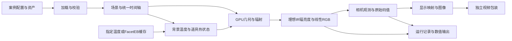

# 现有游戏场景模拟技术的代码归并设计

状态：设计建议；2026-11-09根据实际源码和当前案例核对。本文不表示以下新模块已经实现。

当前主案例是原小镇、跑道、道路上的通用热组件v4：
`D:/cases/StreamStudio/supplemental/impact_gpu_20261107/mwir_runway_road_generic_20261109`。

## 1. 建议与取舍

沿用`C:/work/streamstudio`中的HiStream可选`animation`模块，形成一套原生运行链。
案例保留几何、材质、热源、相机、时间轴和输出配置；Python负责准备输入、数值参考核对与视频包装。
现有`eSceneAnimation`继续作为引擎入口。C++处理少量道具的热状态，GPU处理几何、辐射与成像。

比较了三种方式，本文推荐第二种，这是本轮的设计判断：

| 方式 | 收益 | 代价／适用性 |
|---|---|---|
| 只将案例Python脚本合成一个包 | 最快复用现有代码 | 正式引擎与案例端仍各有一套波段、探测器和时序实现，跨案例依赖仍需处理 |
| 在现有原生模块逐步收拢，Python保留数值参考与包装 | 统一运行入口、物理量和来源记录，延续已有GPU能力 | 需要分阶段验证CPU／GPU及旧案例兼容；推荐 |
| 建立新的仿真框架或独立引擎 | 可以重新定义所有接口 | 与现有网格、EB、GPU及相机重复，增加维护成本；现阶段收益不足 |

归并的目标是：换道具主要换资产和参数，换相机主要换观测配置，增加案例不再复制求解与成像代码。
本轮按设计任务交付文档和来源清单；实现顺序见[迁移计划](../plans/2026-11-09-simulation-code-consolidation.md)。

## 2. 已有技术与实际缺口

| 技术 | 当前有效位置 | 归并决定 |
|---|---|---|
| 原生入口、构建开关 | `models/histream/src/animation/scene_animation.cpp`、`cmake/scene-animation.cmake` | 保留唯一CLI入口和默认关闭的构建开关 |
| 网格、材质、实例、四视角 | `animation/scene/mesh_scene.*`、`material_table.*`、`bridge/histream_mesh_adapter.*` | 沿用已有加载、变换、ID、哈希和可见性能力 |
| 时间轴、刚体接触、挂载相机 | `animation/sequence/mesh_timeline.*`、`collision/rigid_scene.*` | 先保留旧路径，再抽离通用时间／相机取样，避免改变旧案例 |
| FacetEB温度输入与植被地面热模块 | `animation/thermal/background_field.*`、`ground_thermal.*` | 通过明确的温度来源接入，继续由原求解器负责背景热物理 |
| 任意游戏道具的工作升温／冷却 | C盘v3、v4案例的`generic_thermal.py` | 提取为原生`thermal/actor_thermal.*`；参考Python保留用于验证 |
| 3–5 μm积分与灰体辐射 | 案例`mwir_physics.py`及v4的`band()` | 归入`radiometry/`和对应GLSL，集中常量、单位、积分与波段响应 |
| PSF、像元积分、噪声、响应、ADC、显示 | 原生`observation/camera_observation.*`、旧`SceneSensor`与案例`observe()` | 新功能以原生CameraObservation为主；旧链保留为兼容路径，不串联两次处理 |
| 火、烟、低速输运和外观 | `animation/transport/`、`scene/fire_sources.*`、`shader/animation/mesh/` | 保留可选能力和实际近似范围，后续以参数预设减少重复效果变体 |
| 四路合成、编码和图文包装 | `tools/scene-animation/`和案例打包脚本 | 复用Python工具，不放进热求解或GPU shader |
| 强抖动、区域增益、显示四级量化 | 冻结基准派生的后期案例 | 标为显示效果预设，不作为姿态动力学、物理温差或原始ADC结果 |

实际重复已经存在：v3、v4的`generic_thermal.py`完整SHA-256相同；v2、v3、v4的
`mwir_physics.py`也相同。v1的同名文件不同，不能按文件名直接覆盖。
v4脚本还通过`sys.path`导入历史案例的`prepare_native`，并硬编码多个D盘案例与FFmpeg路径。
这些依赖应首先从活动运行链移除。

已有`animation`目录结构能够承载归并，无需再建立一套平行目录或新的产品仓库。
工作树中已有其他修改，实施仅按本计划的文件范围进行，不重置、提交或清理其他工作。

## 3. 推荐目录

下列树中的“新增”是待实现项，其他目录已有。按职责分组，避免为每种道具建立类。

```text
C:/work/streamstudio/
  models/histream/
    src/animation/
      scene_animation.h/.cpp          # 保留现有公开入口
      scene/                          # 几何、材质、实例；相机与热角色显式配置
      sequence/
        mesh_timeline.h/.cpp          # 原时序保持兼容
        frame_time.h                  # 新增：模拟／视频时间映射
      thermal/
        background_field.h/.cpp       # 已有：原生温度场适配
        ground_thermal.h/.cpp         # 已有：地面热模块
        actor_thermal.h/.cpp          # 新增：通用道具单状态热模型
        actor_binding.h/.cpp          # 新增：实例、材质和热权重的预处理
      radiometry/
        spectral_band.h/.cpp          # 新增：波段、积分权重、单位和校验
      observation/
        camera_observation.h/.cpp     # 新功能的统一观测链
      sensor/                         # 旧SceneSensor仅维护兼容
      render/                         # 场景／道具热状态进入同一渲染链
      transport/                      # 可选的热／烟输运
      collision/                      # 可选的已有刚体接触
      bridge/                         # 接入原网格、温度场
    shader/animation/
      radiometry/band.glsl            # 新增：统一光谱与波段计算
      camera/                         # 已有：曝光、PSF、探测器、显示
      mesh/                           # 已有：几何及可选效果
  tools/scene-animation/
    run_case.py                       # 新增：配置检查、调用引擎、包装输出
    import_legacy_case.py             # 新增：显式转换旧案例配置
    reference/                       # 新增：独立数值参考；生产链不调用
    presets/                         # 新增：相机与显示效果JSON
    tests/                           # 沿用现有轻量检查目录
    render_video.py                   # 已有：编码与展示
```

不另建顶层`Tests`，相关检查继续放在已有`tools/scene-animation/tests`。
正式引擎源码在C盘仓库，研究准备脚本与临时检查在`C:/cases/StreamStudio`，
案例输入和结果沿用现有D盘路径。大资产和连续帧不复制进代码仓库。

## 4. 单次运行的数据链



每个模拟时刻先推进一次世界状态，再让全部相机读取同一状态。
增加相机或调整视图顺序不应改变物体温度。曝光子采样从同一时间区间的状态插值取得，
不能为每个相机重复推进热状态或烟场。相机各自保存响应历史；随机数按运行种子、
相机ID、通道和帧号派生，固定图样噪声保持跨帧固定。

模拟时间`s_sim`、视频时间`s_video`与曝光秒数分开记录。
当前20分钟热过程压缩到12秒属于时间压缩展示，不能把视频帧间隔直接当热求解步长。
几何、温度、相机姿态和曝光都使用明确的模拟时间；原四相机动画仍保持其原始时间轴。

## 5. 小接口与数据约定

### 5.1 继续使用现有引擎入口

```cpp
// 已存在的公开入口保持不变。
int runSceneAnimation(const std::filesystem::path& input,
                      const std::filesystem::path& output,
                      const std::filesystem::path& shader,
                      const std::filesystem::path& executable);

// 以下是待新增的内部数值接口，不是另一套产品入口。
struct ActorHeatParameters {
    double capacityJPerK;
    double convectionWPerK;
    std::array<double, 4> radiation;
    double powerW;
};
struct ActorHeatState { double deltaK; };
struct ActorHeatStep { ActorHeatState state; double residualW; };

ActorHeatStep advanceActorHeat(ActorHeatState previous,
                              const ActorHeatParameters& parameters,
                              double dtSeconds, double activity);
```

热核不接收道具类型、相机、文件路径、GPU或JSON；参数由加载／预处理阶段一次导出。
沿用当前隐式Euler和非线性散热方程，先以double在CPU更新；少量道具没有必要增加GPU调度。
温度／空间权重进入GPU渲染时用独立缓冲区，按稳定实例ID绑定，避免逐帧重新构造几何。
不静默改变现有`Triangle`的128字节std430布局；新增缓冲区时显式检查长度、步幅与ID映射。

当前单状态模型是等效热容量加空间热权重的游戏近似；有效面积上限也是外表面积代理。
归并不将这些参数变成实测车型温度，也不自动加入内部传导、多节点热网络或真实燃烧。
v2双状态方法保留为历史参考，等出现明确的新增需求再作为独立可选实现接入。

### 5.2 三种温度来源

- `prescribed`：材质或实例指定温度，明确记录为输入。
- `faceteb_cache`：读取与几何、材质、变换和时间匹配的原生结果，并记录来源哈希。
- 道具工作热源：在选定且明确的背景参考温度上施加单状态增量。

背景缓存匹配失败直接报错；不因文件缺失改用常数温度。
首轮工作热源采用当前固定参考背景的假设。动态背景需要单独定义基线变化时的能量方程，
不能把变动的绝对温度直接塞进现有增量方程。
植被或新增物体造成的地表温差必须来自相应热求解；阴影和IR显示偏移单独标注。

### 5.3 资产和材质决定参数，类型名称不决定算法

所有道具统一描述`power_w`、`heated_mass_kg`、`specific_heat_j_kg_k`、
空间热权重及有效面积策略。热点坐标在资产规范局部坐标中归一化；世界变换只处理几何与面积尺度。
用显式`thermalWeight`或`thermalRole`替代生产链对`window/glass/wheel/black`名称的字符串猜测。
旧转换器可重现原规则，但必须把导出的权重及转换版本写入记录。

### 5.4 光谱、探测器、显示分开

| 产品 | 内容与单位 | 存储与校验 |
|---|---|---|
| 温度状态 | K；或明确命名的温升K | float与热收支残差W |
| 单波长辐亮度 | W·m⁻²·sr⁻¹·μm⁻¹ | float；记录波长μm |
| 波段积分辐亮度 | W·m⁻²·sr⁻¹ | float；记录3–5 μm、17点Simpson及响应权重 |
| 线性RGB | 当前渲染链的无量纲线性颜色 | float；不声称绝对光度标定 |
| 探测器码值 | DN，当前示例12 bit | uint16容器；范围0…4095 |
| 显示图 | 8 bit灰度或RGB | PNG；记录固定范围／百分位及重建方式 |
| 展示视频 | 带布局与标题的图像序列 | MP4和帧时间表；属于展示产物 |

3–5 μm的平坦响应积分保持当前绝对积分语义；以后增加响应曲线时记录曲线与权重哈希，
明确积分与归一化平均的区别。旧单波长路径继续明确标为单波长，不在运行时改称波段结果。

物理相机链：线性信号 → 曝光／PSF／像元积分 → 响应与噪声 → ADC → 显示映射。
RGB和IR各有独立的采样、滤波与噪声配置。当前清晰RGB可禁用其额外退化，IR独立保持低分辨率。
`display.percentiles=[2,98]`只影响显示，不改理想辐亮度与原始ADC码值。
通用噪声参数继续标为未标定，后期“每通道四级显示”与真正降低`adc_bits`采用不同预设名称。

### 5.5 输出与来源记录

运行输出必须是新目录；加载、资产哈希和配置检查在创建结果前完成。
源资产路径相对案例配置解析，运行程序路径由参数明确给出或使用仓库既定解析规则。
禁止正式模块导入`C:/cases`或`D:/cases`中的历史Python代码；历史数据只作为显式输入引用。

首轮使用当前已有的F32／PNG16／CSV及JSON方式，按产品区分目录，不新增复杂文件格式依赖：

```text
new-run/
  input/                    # 实际使用的配置与输入引用
  state/                    # 时间、温升、热收支与所选诊断
  ideal/                    # 原始辐亮度／线性RGB
  detector/                 # 探测器码值与尺寸
  display/                  # 显示PNG
  video/                    # 独立包装结果，可选
  timeline.csv              # frame、simulation_seconds、presentation_seconds、validity
  run-manifest.json         # 引擎／shader／源码／资产／预设版本和实际能力
```

只持久化显式请求的产品；未保存的产品仍可在内存中计算。清单报告请求项、实际写出项和失败项，
不把目录存在当成“已经打开存储”。旧版本输出目录和文件名由兼容路径维持。

## 6. 能力状态必须随结果保存

当前v4实际是“GPU几何与RGB、CPU热状态和波段／相机处理”。归并后才逐项改变运行位置。
运行清单记录每项计算的CPU／GPU实现、来源和近似范围。

火焰、烟雾、刚体接触、预设外观变化和背景热求解分别登记。
已有低速输运不等于真实燃烧或冲击波求解；预设建筑开洞也不等于结构破坏计算。
仅当代码路径实际运行并产出对应诊断，才把该项标为启用。
暂未实现的大气、光谱太阳反射或温度反馈选项必须拒绝或报告不支持，不能接受配置后静默忽略。

## 7. 迁移与验收

1. 先收集数值参考与契约，再移植通用热核。第一轮不改变公式、默认参数或资产布局。
2. 接入波段积分与热状态，使用原场景生成独立新运行目录。
3. 统一新观测路径，明确旧观测链兼容与显示预设。
4. 将四相机时间、有效帧和输出策略收拢，最后再减少效果shader变体与生成脚本重复。

每步提供独立检查。主要门槛包括：

- 热核独立解析解、零功率、升温／冷却和非线性收支；同参数不因道具名称改变结果。
- 相机数量及顺序变化不改变热状态；部分帧读取重放前史或明确报错，禁止静默错位。
- CPU参考与GPU波段图在共同采样定义下比较；不将中心射线和抗锯齿积分混作同一产品。
- 同一ADC数据的不同显示增强不能修改DN或原始辐亮度。
- 原场景20个已有实例、四个原相机、11个资产和材质表保持一致；新增道具是显式追加。
- 原冻结结果和清单保持原路径，测试输出另建目录；构建只更新所需引擎与运行shader。

兼容路径先维持原输出；新模块输出允许按照明确的CPU／GPU数值容差比较。
编码视频有损且可能含随机噪声，不要求用视频哈希代替物理量和原始图像的检验。

## 8. 工程接入范围

StreamStudio／HiStream拥有本次三维运行链。界面后续只编辑与保存配置，沿已有
`project-unified.js`及`engines.histream`接入，不在GUI复制热公式或Planck函数。
StreamImaging当前已经使用StreamStudio的引擎，后续复用同一入口和结果清单。
本次不引入跨仓库Python源码导入，也不把StreamSensor既有观测评价链整体搬入游戏场景模块。

性能优化基于实际计时：先做实例与权重缓存、GPU波段和观测链复用，再评估批量热状态GPU化。
不预先承诺帧率或物理精度提升；归并首先证明复用、来源清晰和数值行为可验证。

配套：[技术来源与目标清单](2026-11-09-simulation-module-map.json)。
